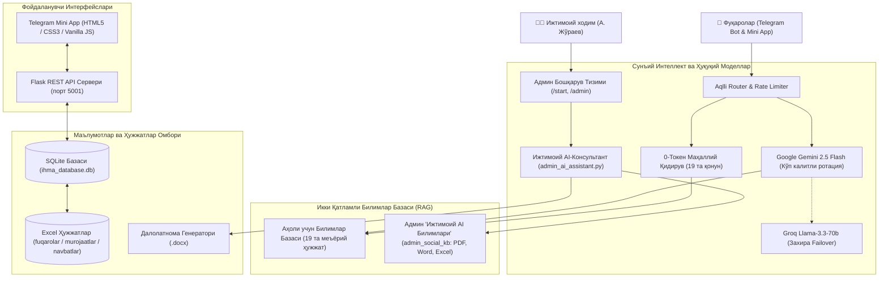
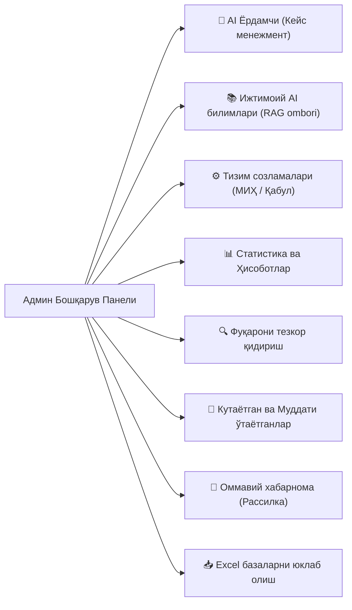

# Қарши шаҳар «Шайх-Али» МФЙ Ижтимоий Ходим AI Agent Тизими: Тўлиқ Вазифаси, Имкониятлари ва Функционал Таҳлили

Ушбу расмий таҳлилий ҳужжат **Қарши шаҳар «Шайх-Али» МФЙ ижтимоий ходими (А. Жўраев)** фаолиятини тўлиқ рақамлаштириш, Ўзбекистон Республикаси Президенти ҳузуридаги **Ижтимоий ҳимоя миллий агентлиги (ИҲМА)** мезонлари асосида фуқароларга 24/7 бепул қонуний кўмак бериш ҳамда ижтимоий кейсларни (*case management*) профессионал бошқариш учун яратилган сунъий интеллект экотизимининг мукаммал тавсифи ҳисобланади.

---

## 1. Тизмнинг Бош Мақсади ва Асосий Вазифалари

1. **Аҳолига 24/7 тезкор, бепул ва холис ижтимоий-ҳуқуқий кўмак кўрсатиш:**
   - Фуқароларга болалар нафақаси («бола пули»), моддий ёрдам, ногиронлик аравачалари ва протез-ортопедия воситалари, реабилитация ваучерлари, «Саховат ва кўмак» жамғармаси маблағлари, зўравонлик ва тазйиқдан жабрланганда «Ҳимоя ордери» олиш тартибларини расмий қонунчилик асосида куну тун тушунтириш.
2. **Ижтимоий ходимнинг иш юкламасини кескин камайтириш:**
   - Бир хил турдаги такрорий саволларга сунъий интеллект орқали автоматик жавоб бериш, фуқаролар мурожаатларини тоифаларга ажратиш (*triage*), электрон навбатни ташкиллаштириш ва 1 та тугма орқали расмий Далолатнома (*.docx*) шакллантириш орқали ортиқча қоғозбозлик ва сарсонгарчиликни йўқотиш.
3. **Ижтимоий кейслар бўйича профессионал AI-Консультант (Кейс менежмент):**
   - Оғир ҳаётий вазиятга тушган фуқаролар бўйича 4 босқичли комплекс таҳлил ўтказиш ва «Маҳалла бешлиги» иштирокидаги расмий ҳужжатлар лойиҳасини автоматик тайёрлаш.
4. **Шахсий маълумотлар дахлсизлигини таъминлаш (ЎРҚ-547 қонуни):**
   - Фуқароларнинг ЖШШИР, паспорт ва телефон маълумотларини ташқи AI серверларига чиқиб кетишини тўлиқ ниқоблаш (*PII masking*) орқали қонуний хавфсизликни 100% таъминлаш.

---

## 2. Экотизимнинг Умумий Архитектураси ва Технологик Таркиби



---

## 3. БИРИНЧИ ҚИСМ: Фуқаролар Учун Хизматлар ва Имкониятлар

Фуқаролар ботдан ҳам **Telegram классик чат менюси**, ҳам замонавий **Telegram Mini App (TMA)** дастури орқали фойдалана оладилар.

### 1. Тезкор 0-Токенли Ҳуқуқий Маслаҳат (*Local Legal Advisor*)
- **Вазифаси:** Фуқаро савол ёзганда, ташқи API (Gemini/Groq) га мурожаат қилмасдан, сервер хотирасидаги маҳаллий базадан сониянинг мингдан бир улушида аниқ қонуний моддани топиб бериш.
- **База ҳажми:** 19 та расмий қонунчилик ҳужжати (ЎРҚ-1174, ЎРҚ-1175, ВМ-62, ВМ-654, ПҚ-107, ПҚ-330 ва бошқалар).
- **Имконияти:** Оилавий даромад, нафақа олиш тартиби, ногиронликни белгилаш, протез-ортопедия воситалари, ёлғиз кексаларга қараш бўйича саволларга 0 харажат (0-token) билан 100% аниқ жавоб беради.

### 2. Google Gemini 2.5 Flash Ақлли AI Маслаҳатчи
- **Вазифаси:** Фуқаронинг эркин тилда ёзилган, ностандарт ёки мураккаб ҳаётий саволларини чуқур ҳуқуқий таҳлил қилиш.
- **Имконияти:**
  - Саволга самимий ва ҳамдардлик билан муносабат билдириш.
  - Аниқ 4 қадамли ечим бериш (Бирламчи чоралар -> Босқичма-босқич ҳаракатлар -> Керакли ҳужжатлар -> Ижтимоий ходим билан боғланиш).
  - Кирилл ва лотиндаги сўровларни тушуниб, фақат **Ўзбек Кирилл алифбосида** бехато жавоб қайтариш.
  - Агар Gemini API лимити тўлса, тизим бир зумда иккинчи калитга ёки захирадаги **Groq Llama-3.3-70b** моделига автоматик уланади.

### 3. Интерактив Нафақа ва Бола Пули Калькулятори (ВМ-62 ва ВМ-654)
- **Вазифаси:** Оиланинг «Ижтимоий ҳимоя ягона реестри» орқали болалар нафақаси ёки моддий ёрдам олиш эҳтимолини олдиндан баҳолаш.
- **Ҳисоблаш мезонлари:**
  1. Оила аъзоларининг умумий сони (катталар ва болалар).
  2. Оиланинг бир ойлик жами расмий даромади (иш ҳақи, пенсия, алимент ва бошқалар).
  3. Оилада меҳнатга лаёқатли, аммо узрсиз расмий ишламайдиган аъзолар сони.
  4. Чорва моллари мавжудлиги (қорамол, от, қўй/эчки, парранда).
  5. Деҳқон ва томорқа ер майдони ҳажми (сотихда).
  6. Оила аъзолари номидаги автотранспорт воситаси (ишлаб чиқарилган йили 7 йилдан янги бўлмаслиги).
- **Натижа:** Жон бошига тўғри келадиган ўртача даромадни базадаги **МИҲ суммаси (669 000 сўм)** билан таққослайди. Агар рад этилиш хавфи бўлса, аниқ сабабларини кўрсатиб беради.

### 4. Электрон Навбат (Қабулга Онлайн Ёзилиш)
- **Вазифаси:** Ижтимоий ходим қабулига маҳалла идорасида навбат кутиб туришнинг олдини олиш.
- **Имконияти:**
  - Яқин 7 кунлик қабул кунларини календарь шаклида танлаш (Якшанбадан ташқари).
  - Бўш вақт слотларидан бирини (09:00, 10:00, 11:00, 14:00, 15:00, 16:00, 17:00) банд қилиш.
  - Фуқарога автоматик махсус электрон чипта (`ШАЙХ-XXXX`) ва QR-код генерация қилиш.
  - Ижтимоий ходимга Telegram орқали қабулга ким ёзилгани ҳақида зудлик билан хабарнома бориши.

### 5. Расмий Мурожаат Йўллаш ва Статусни Кузатиш
- **Вазифаси:** Ижтимоий ходимга бевосита онлайн ариза ва мурожаат йўллаш.
- **Имконияти:**
  - Мурожаат йўналишини танлаш (Болалар нафақаси, Ногиронлик ва ваучер, Тазйиқдан ҳимоя, Ижтимоий реестр ва ҳ.к.).
  - Муҳимлик даражасини белгилаш (Оддий, Ўрта, Шошилинч 🚨).
  - Ҳар бир мурожаатга ноёб ID рақам берилади. Фуқаро исталган вақтда «Мурожаатим ҳолати» бўлимидан ижро ҳолатини (*Янги*, *Жараёнда*, *Қаноатлантирилди*, *Рад этилди*) кузатиши ва баҳолаши (1-5 юлдузли CSAT) мумкин.

### 6. Шошилинч Ҳуқуқий Ёрдам (Қизил Йўлак)
- **Вазифаси:** Оғир ҳаётий вазиятлар (тазйиқ, оилавий зўравонлик, оғир бетоблик) юз берганда зудлик билан тезкор ёрдам алгоритмини ишга тушириш.
- **Имконияти:** Ички ишлар (102), Тез ёрдам (103), ҳудудий профилактика инспектори ва «Ҳимоя ордери» олиш тартиби бўйича аниқ йўриқнома беради.

### 7. Telegram Mini App (TMA) — Мобил Илова
- ИҲМА брендининг **Оқ ва Зумрад Яшил** рангларида ишланган нафис ва тезкор мобил веб-дастур.
- 5 та асосий бўлим (Асосий саҳифа, Калькулятор, AI Ёрдам, Навбат, Аризаларим).
- Аккордеон кўринишидаги «Энг Кўп Бериладиган Саволлар» бўлими.

---

## 4. ИККИНЧИ ҚИСМ: Ижтимоий Ходим (Админ) Бошқарув Тизими

Ижтимоий ходим (`ADMIN_ID: 7840350353`) ботга кирганда ёки `/start`, `/admin` буйруғини юборганда тўлиқ маъмурий назорат панели очилади.



### 1. 🧠 Ижтимоий Ходим AI-Консультанти (Кейс менежмент)
Админ мураккаб фуқаролик кейсини матн, овозли хабар ёки фотосурат (ариза/ҳужжат) шаклида киритганда, AI тизим қуйидаги 4 босқичли қатъий алгоритмда ечим тайёрлайди:
1. **Вазиятнинг ҳуқуқий баҳоси:** ИҲМА низомлари ва ВМ қарорларининг тегишли моддаларига тўғридан-тўғри ҳаволалар.
2. **Амалий ҳаракатлар алгоритми:** Ижтимоий ходим қилиши керак бўлган қадамба-қадам кўрсатмалар (1-қадам, 2-қадам...).
3. **Ижтимоий хизмат тури ва асослар:** Қайси ёрдам тури тўғри келиши ва аризани қабул қилиш ёки рад этишнинг қонуний асослари.
4. **«Маҳалла бешлиги» Далолатномаси қорамаси:** МФЙ раиси Ш. Қодиров, ҳоким ёрдамчиси Д. Қўчқаров, хотин-қизлар фаоли Н. Авазова, ёшлар етакчиси Ж. Саттаров ва ижтимоий ходим А. Жўраев имзолайдиган расмий далолатнома матни.

#### Интеграция ва чиқариш имкониятлари:
- **📄 Word (.docx) далолатнома генератори:** Жавоб тагидаги «Далолатномани Word (.docx) да юклаш» тугмаси босилганда, ҳужжат автоматик равишда расмий шрифт, жадвал ва маҳалла бешлиги имзолари учун жойлари билан тайёр шаклда файл сифатида юборилади.
- **📖 Telegraph (Instant View):** Telegram лимитларига сиғмайдиган катта ва мукаммал таҳлиллар тўлиқ безатилган саҳифа кўринишида Telegraph платформасида бир зумда очилади.

### 2. 📚 «Ижтимоий AI Билимлари» (Махсус RAG Омбори)
- **Алоҳида муҳит:** Фуқаролар кўрадиган базадан бутунлай мустақил, фақат ижтимоий ходимнинг шахсий методик базаси (`admin_social_kb`).
- **Ҳужжат юклаш:** Админ Telegram чатига PDF, Word (`.docx`), Excel (`.xlsx`) ёки оддий матн юборганда, тизим ичидаги матнни автоматик ажратиб олади, тозалайди ва сунъий интеллект хотирасига RAG парчалари сифатида муҳрлайди.
- **База назорати:** Юкланган ҳужжатлар рўйхатини кўриш, уларнинг ҳажмини билиш ва керак бўлмаганини 1 та тугма билан ўчириш.

### 3. ⚙️ Тизим Созламалари Панели (`/sozlamalar`)
Админ кодга тегмасдан туриб, бот интерфейси орқали қуйидагиларни динамик бошқаради:
- **МИҲ суммасини ўзгартириш:** Масалан, 669 000 сўмни янги қийматга (масалан, 700 000 сўм) ўзгартириш. Бунда Mini App'даги калькулятор автоматик янги сумма бўйича ҳисоблашни бошлайди.
- **Электрон навбат графигини бошқариш:** Қабул кунлари ва соатларини ўзгартириш.
- **Қабулни вақтинча ёпиш:** Ижтимоий ходим маҳаллада хонадонма-хонадон ўрганишда ёки шошилинч йиғилишда бўлганда, «🔴 Бугунги қабулни вақтинча ёпиш» тугмасини босиб, сабабини ёзади. Mini App фуқароларга бу ҳақда махсус огоҳлантириш кўрсатади ва навбат олишни вақтинча тўхтатади. «🟢 Қабулни қайта очиш» тугмаси билан яна фаоллаштирилади.

### 4. 📊 Тизим Статистикаси ва Мониторинг
- Рўйхатдан ўтган жами фуқаролар сони.
- Шахси тасдиқланган ва тасдиқ кутаётган фуқаролар сони.
- Келиб тушган жами аризалар, кўриб чиқилаётганлар ва шошилинч (қизил) мурожаатлар сони.
- Банд қилинган фаол навбат чипталари сони.

### 5. 🔍 Фуқарони Тезкор Қидириш (`/qidiruv`)
- Админ исм, фамилия, ЖШШИР, паспорт рақами ёки кўча номини ёзиб қидириши мумкин.
- Тизмдаги **Alifbo Normalizatori** туфайли фуқаро исми Кирилл ёки Лотин алифбосида ёзилганидан қатъи назар, қидирув 100% аниқ натижа беради.

### 6. 🚨 Кутаётган ва Муддати Ўтаётган Мурожаатлар (24+ соат SLA)
- Ижро муддати 24 соатдан ошиб кетган ёки шошилинч белгиси қўйилган мурожаатларни алоҳида рўйхат қилиб кўрсатиш.

### 7. 📢 Оммавий Хабарнома (Рассилка)
- **Барчага рассилка:** Маҳалладаги барча рўйхатдан ўтган фуқароларга янги қонун ёки муҳим эълонни тарқатиш.
- **Кўчалар бўйича рассилка:** Фақат муайян кўча (масалан: «Навбаҳор кўчаси») аҳолисига сув, чироқ ёки ўрганиш бўйича мақсадли хабар йўллаш.

### 8. 📈 Ойлик AI Таҳлилий Ҳисоботи (`/xisobot ОЙ-ЙИЛ`)
- Бир ойлик барча мурожаатлар, камчиликлар ва ижтимоий тенденцияларни Gemini AI орқали таҳлил қилиб, раҳбарият учун тайёр ҳисобот генерация қилиш.

### 9. 📥 Excel Базаларни Юклаб Олиш (Он-Деманд)
- Серверда файл блокировкаси ва секинлашув бўлмаслиги учун барча маълумотлар SQLite (`ihma_database.db`) да сақланади.
- Админ тугмани босган вақтда тизим бир неча сония ичида базадан 3 та янги Excel ҳужжатини генерация қилади ва юборади:
  1. `fuqarolar.xlsx` — фуқароларнинг рўйхати ва ҳолати.
  2. `murojaatlar.xlsx` — барча аризалар тарихи ва натижаси.
  3. `navbatlar.xlsx` — қабул чипталари ва навбатлар рўйхати.

---

## 5. УЧИНЧИ ҚИСМ: Хавфсизлик ва Махфийлик Кафолати

| Хавфсизлик омили | Қўлланилган технология | Кафолат ва Таъсири |
| :--- | :--- | :--- |
| **Шахсий маълумотлар ниқобланиши (ЎРҚ-547)** | `utils/pii_masker.py` (Regex алгоритмлари) | 14 хонали ЖШШИР, паспорт ва телефон рақамлари ташқи AI серверларига (Gemini, Groq) юборилмайди, `[ЖШШИР_ЯШИРИЛГАН]` кўринишида алмаштирилади. |
| **Маълумотларнинг локаллиги** | `ihma_database.db` (SQLite 3) | Фуқароларнинг ҳақиқий шахсий маълумотлари фақат локал серверда сақланади ва фақат Далолатнома (.docx) яратишда қўлланади. |
| **Анти-спам ва чекловлар** | `USER_RATE_LIMIT` хотира фильтри | Бир дақиқада 3 тадан ортиқ сўров юборган фойдаланувчилар вақтинча чекланади, бот спам ҳужумларидан ҳимояланган. |
| **API ишончлилиги (Failover)** | Кўп калитли Gemini + Groq Llama-3.3-70b | Агар бир Gemini API калити квотага етса, тизим иккинчи калитга ва сўнг Groq захирасига автоматик ўтади. |
| **Овозли хабарлар хавфсизлиги** | Groq Whisper + Gemini Audio | Овозли хабарлар хотирада транскрипция қилиниб, ортиқча файллар зудлик билан тозаланади. |

---

## 6. Тўлиқ Файллар Тузилмаси

```
IHMA BOT/
├── main.py                     # Асосий Telegram бот, роутерлар ва воқеалар диспетчери
├── admin_ai_assistant.py       # Ижтимоий ходим AI-консультанти, Далолатнома ва RAG тизими
├── webapp_server.py            # Telegram Mini App REST API ва Flask сервери (порт 5001)
├── database.py                 # SQLite маълумотлар базаси ва Word (.docx) генератори
├── local_legal_advisor.py      # 0-токенли тезкор ҳуқуқий маслаҳатчи
├── knowledge_base.py           # Умумий RAG билимлар базаси (19 та қонун)
├── webapp/                     # Telegram Mini App фронтенд файллари
│   ├── index.html              # Mini App тузилиши (Кирилл алифбосида)
│   ├── style.css               # ИҲМА Зумрад-яшил ва оқ бренд дизайни
│   └── app.js                  # Mini App мижоз логикаси, калькулятор, FAQ ва навбат
├── utils/                      # Ёрдамчи тизим модуллари
│   ├── pii_masker.py           # Шахсий маълумотларни ниқоблаш (ЎРҚ-547)
│   ├── text_normalizer.py      # Кирилл/Лотин алифболарини стандартлаштириш
│   └── audio_transcriber.py    # Овозли хабарларни транскрипция қилиш (Groq Whisper)
├── admin_social_kb/            # Админнинг ёпиқ AI билимлар омбори
│   ├── kb_index.json           # Индексланган ҳужжатлар реестри
│   └── telegraph_token.json    # Telegraph ҳисоб маълумотлари
├── dalolatnomalar/             # Генерация қилинган Word (.docx) далолатномалари
├── hujjatlar/                  # 19 та расмий норматив-ҳуқуқий ҳужжатлар тўплами
├── ihma_database.db            # Асосий SQLite базаси
├── ishga tushiring.command     # macOS учун 1 та босишда ишга тушириш скрипти
└── requirements.txt            # Керакли Python кутубхоналари рўйхати
```

---

## 7. Хулоса

Мазкур тизим Ўзбекистон миллий ижтимоий ҳимоя тизимида **биринчи бор маҳалла даражасида тўлиқ интеграция қилинган профессионал сунъий интеллект экотизими** ҳисобланади. У бир вақтнинг ўзида:
1. Фуқаролар учун энг қулай, шаффоф ва 24/7 ишлайдиган рақамли дарча;
2. Ижтимоий ходим (А. Жўраев) учун ҳуқуқий маслаҳатчи, ҳужжат генератори ва бошқарув офиси вазифасини бажаради.
